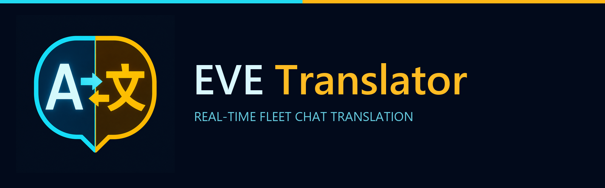

# EVE Translator

Real-time overlay translator for EVE Online Fleet, Local, and other logged chat channels. Built for everyday EVE pilots with guided log and translation-provider setup.

  

## What It Does
- Three overlays: Fleet, Local, and Any Chat (toggle each independently).
- Any Chat follows one selected Corp, Alliance, intel, or custom channel; it never merges duplicate logs from multiple characters.
- Combat, Bilingual, and Mirror HUD modes with a compact readiness/provider header.
- Exact command cards generated from the original line, with explicit FC/scout/starred roles.
- Immediate originals while translation runs; translated lines always keep the original visible.
- EVE-aware translation using language-pair glossaries, 46,000+ protected SDE names/aliases, and ID-linked locale mappings for 6,263 published inventory types; player aliases remain glossary-driven.
- Local exact corrections, safe importable doctrine packs, provider-native burst batching, and opt-in context assist.
- Outbound fleet-message composer with manual clipboard copy only; it never types into or automates EVE.
- DeepL quota display, a Google local character estimate, and an optional explicitly consented second-provider fallback.
- Explicit DeepL Free/Pro or Google provider selection; cloud translation is off until you choose one.
- Auto-detects your active character log and updates Local automatically.
- Always-on-top windows you can drag, resize, and right-click for quick actions.
- Readiness states show whether Fleet, Local, and Any Chat are off, waiting for a log, active, or in error.

## Requirements
- Windows PC running EVE Online.
- Choose a provider in Settings. DeepL requires a Free or Pro API key; Google does not require a key.
- Google mode uses Google Translate's public mobile web endpoint rather than an official Google Cloud API. It may be rate-limited or changed by Google.
- Selecting Google or DeepL sends message text to that cloud provider. Translation remains disabled until you explicitly select one.
- EVE client chat logging enabled. In EVE: **Settings → Chat → Log Chat to File**.

### How to get a Free DeepL API Key
1. Go to [https://www.deepl.com/pro-api](https://www.deepl.com/pro-api).
2. Choose **DeepL API Free** (it’s separate from the Translator app).
3. Create an account or sign in.
4. Once subscribed, open your account dashboard → API plan → copy the **Authentication Key**. Free keys typically end with `:fx`.
5. In the app, select DeepL and paste the key into **Settings → DeepL API Key**.
6. Keep the key private; it’s tied to your account and monthly quota.

## Quick Start (Players)
1. Download: grab the latest `EVETranslator_vX.Y_windows_x64.zip` from the GitHub [Releases Page](https://github.com/emyth-juk/eve-translator/releases).
2. Extract the ZIP, then run `EVETranslator_vX.Y.exe` from the extracted folder. Keep the accompanying notices and license files with it.
   The current Windows builds are unsigned, so Microsoft Defender SmartScreen may show an unrecognized-app warning.
   Tagged release notes include the executable's SHA-256 and an automated VirusTotal report. Treat the findings as a point-in-time multi-engine summary, not a guarantee of safety, and use `SHA256SUMS.txt` in the ZIP to verify the downloaded executable.
3. Choose translation: open **Settings → Provider**, select Google or DeepL, and review the cloud-use notice.
4. For DeepL, enter your API key and use **Test Provider** before saving.
5. Point to your chat logs if needed: Settings → Log Directory (default is usually auto-detected).
6. Use it in game: position the overlays, adjust opacity/font size, and right-click for options (Settings, Export Logs, Toggle Sessions, Switch Chat).
7. When positioned, use **Lock overlays** in the tray or **Ctrl+Shift+L** while EVE has focus to pass mouse input through all overlays.
8. Use **Compose translation** in the tray or **Ctrl+Shift+T** to translate an outgoing call, review it, and copy it manually into EVE.

## First-Time Setup Details
- Config file location: `%USERPROFILE%\.eve_translator\translator_config.json` (auto-created).  
- Provider choice: **Disabled** makes no cloud calls; **Google** and **DeepL** send message text to their respective services.
- First-run provider guidance returns on later launches until you open Settings and save an explicit choice, including Disabled.
- Provider test: sends only a built-in connection-test phrase, never fleet chat.
- Context assist is off by default. When enabled with a provider that supports native context, recent lines from only the same channel/log source are also sent to that provider.
- Provider fallback is off by default. Enabling it explicitly consents to sending a failed message—and enabled context-assist lines—to the other cloud provider only after the primary provider fails.
- **Refresh Usage** reads exact DeepL character usage. Google does not expose an account quota through this integration, so its figure is clearly labelled as a local runtime estimate.
- Colors and UI: set default/translated/highlight colors in Settings; changes are live.  
- Translation Intelligence: manage SDE name protection, burst optimization, context consent, exact local corrections, and one active doctrine pack.
- Glossaries are selected from the detected source and target language pair. User overrides go in `%USERPROFILE%\.eve_translator\glossaries\`.
- Ignored-language entries are matched by base language: `zh` ignores Chinese, `ja` ignores Japanese, and `ko` ignores Korean independently; regional forms such as `pt-BR` match `pt`.
- Corrections are exact, language-pair scoped, and stored locally in `%USERPROFILE%\.eve_translator\translation_memory.sqlite3`.
- Local corrections can be exported as schema-v2 doctrine ZIPs; full messages remain exact corrections and are never converted into substring glossary rules.
- Doctrine packs are data-only ZIPs validated before installation under `%USERPROFILE%\.eve_translator\doctrines\`; they cannot grant FC/scout trust. See `data/doctrines/README.md` for the pack schema.
- Logs: app logs live in `%USERPROFILE%\.eve_translator\logs\`.

## Controls & Interactions

### Moving & Resizing
- **Move**: **Right-Click and Drag** anywhere on the overlay to move it.
- **Resize**: 
    - Drag any **edge** or **corner** of the window.
    - Use the **Resize Grip** in the bottom-right corner.
    - Windows can be resized down to very compact dimensions (120x80px).

### Context Menu
- **Right-Click** (release without dragging) to open the menu:
    - **Settings**: Configure API keys, colors, fonts, and opacity.
    - **Toggle Chat**: Enable or disable Fleet, Local, and Any Chat overlays.
    - **Export Recent History**: Save the overlay's latest 100 message states to a file.
    - **Switch Character/Fleet/Chat**: Manually choose the Local character, Fleet, or arbitrary chat source.
    - **Display Mode**: Switch Combat, Bilingual, and Mirror instantly without retranslating history.
    - **Speaker Role**: Mark the latest speaker as FC, Scout, Starred, or remove the role.
    - **Improve Last Translation**: Save an exact local correction for the latest translated line.

### HUD Modes
- **Combat**: trusted exact-command cards plus messages from explicitly starred FC/scout speakers.
- **Bilingual**: translation-relevant messages and starred speakers, with translation first and original below.
- **Mirror**: every parsed chat line; this remains the migration-safe default for existing configurations.

Speaker roles are exact, local mappings. The app never infers authority from a name containing “FC”, and doctrine imports cannot silently trust identities. Command cards are classified from the source text before cloud translation; unstarred commands are labelled **Unverified**.

### Any Chat

- Enable **Any Chat** from the tray. On first enable it chooses the newest currently open non-Fleet/non-Local log.
- Choose a specific source from **Any Chat Source** in the tray or **Switch Chat** in the Any Chat overlay. Choices are shown as `Channel - Character`.
- The selection survives relogs and follows only a newer log for that same channel and character. It does not jump to whichever channel receives the newest message.
- EVE chat logs do not report which chat tab is currently visible, so switching the in-game tab does not automatically retarget the overlay.
- Fleet and Local are excluded from Any Chat to prevent duplicate display and duplicate provider usage.

### System Tray Readiness
- **Off**: the session is disabled.
- **Waiting**: enabled and watching for the selected EVE chat log to become active.
- **Active**: the overlay is following a live chat log.
- **Error**: the log or session could not be opened; hover the tray action for details.
- Waiting sessions start automatically when their log appears. Settings is always available from the tray.
- **Lock overlays** enables true click-through for all overlays. The global shortcut uses Windows `RegisterHotKey`, not a keyboard hook; the tray remains the recovery path if the shortcut is unavailable.
- **Compose translation** opens a separate review-and-copy window. Its global shortcut also uses `RegisterHotKey`; no keystrokes or clipboard contents are injected into EVE.
- Only one translator process runs at a time. Launching it again reports that the existing instance is already available in the system tray instead of stealing its shortcuts.

### Features
- **Auto-Switching**: Local overlay detects system changes and updates automatically.
- **Protected Content**: EVE links and 46,000+ SDE names/aliases are protected from provider corruption. For 6,263 published inventory types, official names are first resolved by SDE type ID to the selected target locale when available, otherwise to English.
- **Burst Translation**: DeepL can translate compatible bursts in one provider request; Google remains sequential because its library batch helper is not a true network batch.

## Troubleshooting
- No translations? Confirm that Google or DeepL is explicitly selected, run **Test Provider**, and ensure EVE chat logging is on.
- An amber warning means the original is being shown because the selected provider is unavailable or failed. Disabled mode quietly leaves messages untranslated.
- Wrong log path? Update it in Settings; the path typically ends with `Documents\EVE\logs\Chatlogs`.  
- Still seeing a default icon on Windows? Clear icon cache or rename the exe; the embedded icon is correct.  
- Logs for support: `%USERPROFILE%\.eve_translator\logs\translator.log`.

## For Developers (optional)
- Supported development interpreters: Python 3.10, 3.11, and 3.12 on Windows; release builds use Python 3.10.
- Runtime install: `python -m pip install -r requirements.txt`
- Development install: `python -m pip install -r requirements-dev.txt`
- Run: `python -m src.main`
- Tests: `python -m pytest`
- Lint: `python -m ruff check src tests scripts packaging`
- Refresh the protected-name index from a pinned [NoirSoldats EVE SDE Converter](https://github.com/noirsoldats/eve-sde-converter) SQLite release with `python scripts/build_protected_entities.py --help`; see `scripts/README.md`. This project does not reimplement CCP SDE conversion.
- Build (Windows): `build_exe.bat` produces the executable plus `dist/EVETranslator_vX.Y_windows_x64.zip` with its notices, component manifest, checksums, and license texts.

## Legal and Third-Party Notices

EVE Translator is an independent project and is not affiliated with or endorsed by CCP hf.

© 2014 CCP hf. All rights reserved. "EVE", "EVE Online", "CCP", and all related logos and images are trademarks or registered trademarks of CCP hf.

This application uses Qt for Python/PySide6 and Qt under the GNU Lesser General Public License version 3. See `THIRD_PARTY_NOTICES.txt`, `LICENSES/LGPL-3.0-only.txt`, and `LICENSES/GPL-3.0-only.txt` for copyright, source-availability, and relinking information.

## Changelog & Contributing
- Changes: see `CHANGELOG.md`.  
- Contributions: PRs welcome; open an issue to discuss feature ideas.  

Fly safe o7
